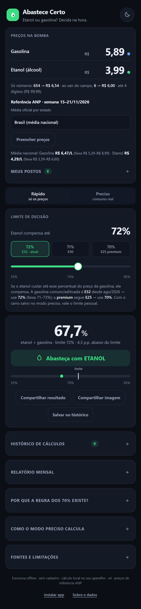
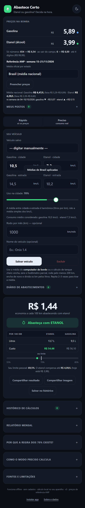
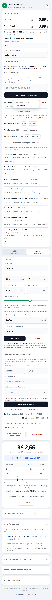
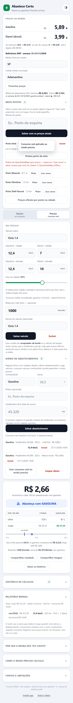
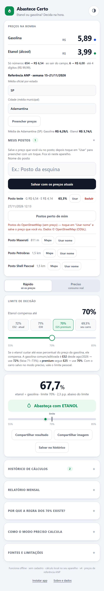
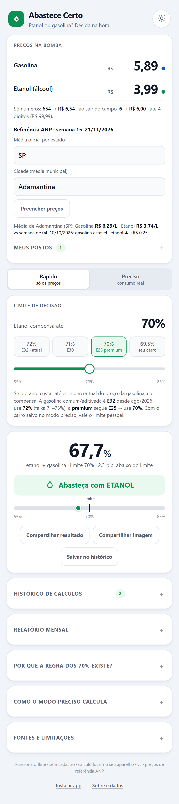

# Abastece Certo — Etanol ou Gasolina

[](https://github.com/atanycost-png/abastece-certo/actions/workflows/quality.yml)

Calculadora **PWA offline** em português que responde na hora: *compensa abastecer com etanol ou gasolina?*

Dois modos, do mais rápido ao mais preciso:

| Modo | O que você informa | O que o app faz |
|---|---|---|
| **Rápido** | preço da gasolina e do etanol | regra dos 70/71/72% (presets E25 premium, E30 e E32 atual) e gauge visual |
| **Preciso** | preços **+ consumo real** do seu carro (km/L com cada combustível) | custo por km, economia por 100 km, **seu limite pessoal** e o preço de equilíbrio de cada combustível |

Nada de cadastro, servidor ou conta: tudo roda no aparelho e continua funcionando sem internet.
O app traz **médias semanais oficiais da ANP** (Brasil, estado, cidade e **preço por posto**) para preencher os preços com um toque,
e guarda um **histórico local** dos seus cálculos com gráfico e exportação em CSV.

**Ao vivo:** <https://atanycost-png.github.io/abastece-certo/> · **Código:** <https://github.com/atanycost-png/abastece-certo>
(A versão publicada atualiza os preços e os postos da ANP sozinha, toda semana, via GitHub Action.)

<p>
  
  
  
  
  
  
</p>

## Recursos

- **Campo de preço inteligente** — digite só números: `654` vira R$ 6,54, `456` vira R$ 4,56; ao sair do campo, `6` completa para R$ 6,00; teto de 4 dígitos (R$ 99,99). Digitação, cola e desfazer são normalizados sozinhos.
- **Tema escuro como padrão** — botão no cabeçalho alterna escuro → automático (segue o sistema) → claro; cada tema tem cores próprias (não é “inversão”) e a escolha fica salva.
- **Preços de referência da ANP** — médias semanais oficiais por **Brasil, estado e cidade** (a amostra semanal traz ~406 municípios) em um `precos.json` gerado por script; a UF e a cidade escolhidas são lembradas. Quando há histórico, mostra a **tendência** (“gasolina ▼ −R$ 0,07 · etanol ▲ +R$ 0,15 vs semana de …”).
- **Preços oficiais por posto** — o app lista até 20 postos da cidade, em ordem de preço da gasolina. **Usar preço** preenche gasolina, etanol e nome do posto quando a pesquisa traz os dois preços.
- **Meus postos** — salve o preço que você viu no posto (nome + gasolina + etanol) e toque em “Usar” para preencher os dois campos com um toque; tudo fica no aparelho (até 15 postos).
- **Postos perto de mim** — com um toque, usa a sua localização (só na hora, nada é guardado) e lista os postos num raio de 2 km via **OpenStreetMap** (Photon/Komoot, com Overpass de reserva); dá para abrir no Google Maps ou copiar o nome para salvar o preço. Se os serviços do OSM não responderem, o app abre o Google Maps. A última lista fica salva: offline, ele mostra **“últimos postos vistos em …”**.
- **Custo mensal estimado** — informe quantos km você roda por mês no modo preciso e veja o gasto mensal com o combustível vencedor.
- **Consumo cidade/estrada** — informe o km/L na cidade e na estrada para cada combustível e ajuste quanto você roda na cidade (padrão 70%); a média é harmônica e o limite pessoal sai do consumo ponderado.
- **Diário de abastecimentos** — para um veículo, registre litros, hodômetro, nível do tanque após abastecer e, se quiser, o nome do posto. O consumo usa pares consecutivos de tanque cheio com o mesmo combustível. Excluir um registro invalida a medição que começava nele. Registros antigos continuam no diário e contribuem para o custo quando têm preço salvo.
- **Relatório mensal** — custo por mês (litros × preço salvo no registro), km/L médio, economia acumulada comparando com o outro combustível e **economia por posto**; atualiza sozinho conforme o diário.
- **Aviso de dados antigos** — se a semana da ANP tiver mais de 14 dias, um selo no topo mostra a data e abre o “Sobre” para atualizar.
- **Backup e restauração** — exporta um JSON com histórico, veículos, diário, postos, tema e preços; importar restaura no aparelho novo (com confirmação e validação).
- **Histórico local** — salve cálculos (com o veículo usado), veja a evolução do índice num gráfico próprio (SVG) e exporte em CSV compatível com Excel.
- **Compartilhar resultado ou imagem** — texto pela folha de compartilhamento (ou cópia) e cartão PNG gerado no próprio aparelho para mandar no WhatsApp.
- **Instalação assistida** — quando o navegador permite, aparece o botão **Instalar app**; no iPhone ele ensina o caminho (*Compartilhar → Adicionar à Tela de Início*).
- **Sobre e dados** — versão, semana da ANP, fonte dos preços, **status de instalação** (tela inicial ou navegador, service worker ativo), atualizar preços e apagar tudo o que está guardado no aparelho (com confirmação).
- **Instalável (PWA)** — manifest com screenshots, ícones PNG 192/512 + maskable e service worker próprio; botão de instalação aparece quando o navegador permite.
- **Offline de verdade** — o app abre sem rede depois da primeira visita; o `index.html` também funciona com duplo clique, sem servidor.
- **Perfil de veículo** — salva nome e consumos no `localStorage`; com um toque o limite dos 70% vira o limite real do seu carro.
- **Compartilhar resultado** — usa a folha de compartilhamento do celular e cai para cópia em um toque quando não existe.
- **Acessível** — abas com padrão ARIA, `aria-live` anunciando o veredito e os erros de campo, labels em todos os campos, foco visível (inclusive no slider), alvos de toque confortáveis (44 px nos controles principais), `prefers-reduced-motion` e suporte a alto contraste do sistema.
- **Atualização segura** — service worker com *network-first* na navegação: quem está online nunca fica preso numa versão velha em cache.
- **Zero dependências, zero build** — um único `index.html` autocontido (HTML + CSS + JS) e nenhum arquivo gerado.

## Como usar

**Sem instalar nada:** dê dois cliques em `index.html`. Funciona 100% offline, inclusive em `file://`.

**Instalar no celular (PWA):** publique a pasta em qualquer hospedagem estática com HTTPS (GitHub Pages, Netlify Drop, Vercel, Cloudflare Pages) e use *Adicionar à tela inicial*. O service worker só é registrado em `http(s)`, por isso `file://` não instala — mas calcula normalmente.

**Testar localmente:**

```sh
node tools/serve.mjs        # http://localhost:5173 (localhost conta como seguro)
```

**Preços de referência:** com o app servido por http(s), o bloco "Referência ANP" mostra a semana mais
recente disponível em `precos.json`, com seletor de estado e o botão **Usar médias**. Em `file://` o
`fetch` não funciona, então o app usa o texto de referência embutido.

## Preços semanais (ANP)

`precos.json` guarda as médias nacionais, por UF e por cidade (a amostra municipal da ANP) da semana mais
recente. A pasta `postos/` guarda um JSON compacto por UF com o **preço de cada posto pesquisado** (nome,
bandeira, endereço, gasolina e etanol), baixado sob demanda pelo app. Os dois são gerados **sem
dependências** por [`tools/update-prices.mjs`](tools/update-prices.mjs), que baixa o
`resumo_semanal_lpc_*.xlsx` e o `revendas_lpc_*.xlsx` oficiais e descompacta/lê o XLSX com `node:zlib` +
regex (sem bibliotecas). O parser aceita os formatos de nome que a ANP já usou (`2026-10-04_2026-10-10` e
`2026_11_15_2026-11-21`).

```sh
node tools/update-prices.mjs                 # baixa a semana mais recente: precos.json + postos/
node tools/update-prices.mjs --dry-run       # mostra o que seria gravado
node tools/update-prices.mjs --sem-postos    # só as médias (não baixa revendas)
node tools/update-prices.mjs --file x.xlsx   # usa um resumo já baixado
```

O GitHub Action [`.github/workflows/atualizar-precos.yml`](.github/workflows/atualizar-precos.yml) roda
toda semana, atualiza `precos.json`/`postos` e commita se houve mudança — assim um site publicado no GitHub Pages
ganha preços novos sem backend e sem CORS. O job roda em `macos-latest` porque os runners ubuntu/windows do
GitHub são bloqueados pelo `gov.br` (detalhes em [`docs/DADOS-ANP.md`](docs/DADOS-ANP.md)). O workflow
**falha de propósito** se a semana de referência ficar com mais de 21 dias, para avisar quando a ANP parar
de publicar ou mudar o formato dos arquivos.
Se a planilha de revendas falhar, a automação publica as médias válidas e sinaliza quais UFs ficaram sem preços por posto da semana correspondente.

## Fórmulas

**Modo rápido** — o etanol compensa quando:

```
P_etanol / P_gasolina  <  limite
```

O limite padrão é **72%**, porque a gasolina comum/aditivada brasileira é **E32 desde 01/08/2026**
(Resolução CNPE nº 9/2026, temporária). A gasolina **premium segue E25** → limite **70%**; **E30** (ago/2025–jul/2026) → **71%**.
A tolerância de empate técnico é de 0,5 ponto percentual.

**Modo preciso** — o critério exato é custo por quilômetro:

```
custo_gasolina = P_gasolina / C_gasolina        (R$ por km)
custo_etanol   = P_etanol   / C_etanol          (R$ por km)
```

que é equivalente a comparar `P_etanol / P_gasolina` com o **seu limite pessoal** `C_etanol / C_gasolina`.
O app também calcula:

- **custo por 100 km** de cada combustível;
- **economia por 100 km** da melhor opção;
- **preço de equilíbrio do etanol** = `P_gasolina × C_etanol/C_gasolina`;
- **preço de equilíbrio da gasolina** = `P_etanol ÷ C_etanol/C_gasolina`.

Exemplo (médias ANP de 15–21/11/2026): gasolina a R$ 6,47/L rendendo 12,0 km/L e etanol a R$ 4,29/L rendendo 8,6 km/L →
limite pessoal 71,7% · gasolina R$ 54,50/100 km · etanol R$ 48,14/100 km · **economia de R$ 6,36/100 km**.

## Estrutura

| Arquivo | Papel |
|---|---|
| `index.html` | **O app inteiro.** HTML + CSS + JS embutidos, sem dependências. Inclui o bloco `CORE-START/CORE-END` com a lógica pura. |
| `sw.js` | Service worker (offline + atualização). |
| `manifest.webmanifest` | Manifesto de instalação PWA (com ícones e screenshots). |
| `DESIGN.md` | Contrato de design (cores, tipografia, anti-metas e contratos do DOM) — guia qualquer redesign. |
| `precos.json` | Médias semanais da ANP (Brasil + UF + cidade) e histórico de 8 semanas, gerados por script. |
| `postos/` | Preço oficial por posto, um JSON compacto por UF (`postos/SP.json` etc.), baixado sob demanda. |
| `icons/` | Ícones PNG 192, 512, maskable e apple-touch-icon + `favicon.svg`. |
| `screenshots/` | Capturas usadas no README e no manifest (`install-*` têm tamanho fixo). |
| `mockups/` | Três direções visuais para a v4 (HTML autocontido, abertos no navegador). |
| `tools/test.mjs` | Testes da lógica pura (extrai o bloco CORE do HTML e roda no `node:vm`). |
| `tools/test-dom.mjs` | Testes de integração do app com DOM simulado (migração, storage, XSS, ARIA, histórico, preços). |
| `tools/test-sw.mjs` | Testes de runtime do service worker (install, activate, network-first, offline, update). |
| `tools/test-prices.mjs` | Testes do pipeline de preços (ZIP/XLSX, parse, schema). |
| `tools/check.mjs` | Checagem estrutural: manifesto, ícones/screenshots reais, service worker, ARIA, ids, orçamento de tamanho. |
| `tools/serve.mjs` | Servidor estático local sem dependências (para testar SW/PWA). |
| `tools/visual-check.mjs` | Abre o app no Edge headless via DevTools Protocol, preenche campos, testa modos/histórico/preços e tira screenshots. |
| `tools/update-prices.mjs` | Baixa e converte o XLSX semanal da ANP em `precos.json` (zero dependências). |
| `tools/make-icons.py` | Gera os PNGs dos ícones (Pillow/numpy) — só quando a arte mudar. |
| `.github/workflows/` | Automação semanal dos preços da ANP. |
| `docs/` | Documentação do pipeline de dados. |
| `research/` | Pesquisa e auditorias que embasaram as versões (fontes, APIs, decisões). |
| `REFERENCIA.md` | Referência técnica com histórico datado, decisões e armadilhas. |

## Desenvolvimento

Não há build. Os comandos abaixo são apenas conveniências de desenvolvimento (Node 20+):

```sh
node tools/test.mjs          # testes da lógica pura (parse, cálculo, formatação, gauge)
node tools/test-dom.mjs      # testes de integração do app (DOM simulado)
node tools/test-sw.mjs       # testes de runtime do service worker
node tools/test-prices.mjs   # testes do pipeline de preços da ANP
node tools/check.mjs         # checagens do pacote (manifesto, SW, ARIA, tamanho)
node tools/serve.mjs         # servidor local em http://localhost:5173
node tools/visual-check.mjs  # screenshots + erros de console no Edge headless
node tools/live-check.mjs    # confere o app PUBLICADO (manifest, SW, offline)
node tools/update-prices.mjs # atualiza precos.json a partir da ANP
```

Ou `npm test` para rodar as quatro suítes de teste em sequência.

`tools/visual-check.mjs` e `tools/make-icons.py` exigem, respectivamente, o Microsoft Edge instalado e
Python com Pillow — mas **nenhum dos dois é necessário para usar ou publicar o app**.

## Privacidade

Preços, consumos e histórico ficam só no `localStorage` do seu navegador. A única requisição de rede é o
`precos.json` **do próprio site** (mesma origem, sem terceiros, sem cookies): o app não coleta, não envia e
não compartilha dados.

## Precisão e limitações

- O app **não consulta preços em tempo real**. As médias semanais da ANP chegam por `precos.json`, gerado
  por script/Action (§Preços semanais) — é o máximo possível em um site estático, porque a ANP não libera
  CORS e os arquivos são XLSX/CSV pesados ([`research/FINDINGS.md`](research/FINDINGS.md)). O preço que vale
  é o do posto onde você abastece.- A regra dos 70/71/72% é uma **heurística de consumo** (nasceu com o flex, em 2003), não igualdade de energia:
  o etanol hidratado tem ~66% da energia por litro da gasolina pura e ~73% da gasolina C, mas motores flex
  ganham eficiência com etanol. A relação real varia por motor (tipicamente 0,65–0,78).
- A mistura **E32 é temporária** (180 dias, prorrogável). Se o CNPE mudar o teor, ajuste o limite no controle.
- O modo preciso depende da qualidade dos consumos informados — use o computador de bordo ou pelo menos
  duas medições de tanque cheio.
- O app valida faixas plausíveis: preço até R$ 99,99/L e consumo entre 0,5 e 60 km/L. Fora das faixas
  comuns (gasolina R$ 4,50–9,50; etanol R$ 2,50–7,50; razão etanol/gasolina 50–100%) ele **avisa** em vez
  de esconder o problema — o que pega vírgula digitada errado.
- O app é uma ferramenta de apoio, não uma garantia de economia.

## Fontes

- [ANP — E32 em vigor desde 01/08/2026](https://www.gov.br/anp/pt-br/canais_atendimento/imprensa/noticias-comunicados/e32-gasolina-com-32-de-etanol-passa-a-valer-temporariamente-a-partir-de-amanha-1-8) — Resolução CNPE nº 9/2026, temporária; premium segue E25.
- [MME/CNPE — aprovação do teor de 32%](https://www.gov.br/mme/pt-br/assuntos/conselhos-e-comites/cnpe/comunicacoes/cnpe-aprova-elevacao-do-teor-de-etanol-anidro-na-gasolina-para-32).
- [Estadão / Fecombustíveis — a regra dos 70% e por que ela pode fazer perder dinheiro](https://minaspetro.com.br/etanol-ou-gasolina-entenda-como-a-regra-dos-70-pode-fazer-voce-perder-dinheiro/).
- [AUTOTEMPO / Minaspetro — como calcular com gasolina E32](https://minaspetro.com.br/gasolina-e32-aprenda-a-calcular-se-o-etanol-vale-mais-a-pena/).
- [ANP — Levantamento de Preços de Combustíveis](https://www.gov.br/anp/pt-br/assuntos/precos-e-defesa-da-concorrencia/precos/levantamento-de-precos-de-combustiveis-ultimas-semanas-pesquisadas) — médias semanais.
- [Engineering ToolBox — poder calorífico dos combustíveis](https://www.engineeringtoolbox.com/fuels-higher-calorific-values-d_169.html) — gasolina 32,0 MJ/L, etanol anidro 21,1 MJ/L.
- Levantamento completo (fontes, APIs, bibliotecas avaliadas, riscos): [`research/FINDINGS.md`](research/FINDINGS.md).

## Licença

MIT — veja [`LICENSE`](LICENSE).
