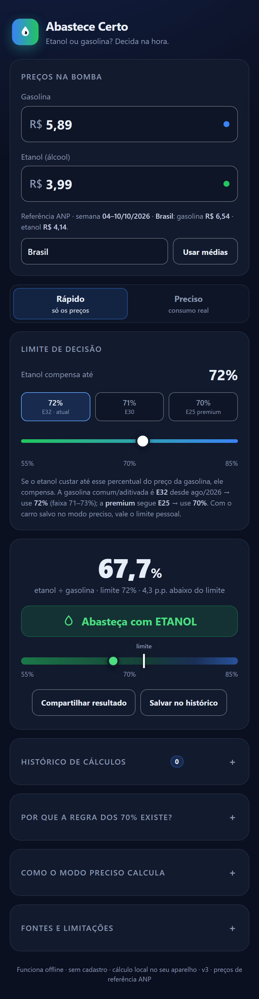
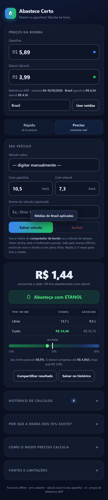

# Abastece Certo — Etanol ou Gasolina

Calculadora **PWA offline** em português que responde na hora: *compensa abastecer com etanol ou gasolina?*

Dois modos, do mais rápido ao mais preciso:

| Modo | O que você informa | O que o app faz |
|---|---|---|
| **Rápido** | preço da gasolina e do etanol | regra dos 70/71/72% (presets E25 premium, E30 e E32 atual) e gauge visual |
| **Preciso** | preços **+ consumo real** do seu carro (km/L com cada combustível) | custo por km, economia por 100 km, **seu limite pessoal** e o preço de equilíbrio de cada combustível |

Nada de cadastro, servidor ou conta: tudo roda no aparelho e continua funcionando sem internet.
O app traz **médias semanais oficiais da ANP** (Brasil e por estado) para preencher os preços com um toque,
e guarda um **histórico local** dos seus cálculos com gráfico e exportação em CSV.

<p>
  
  
</p>

## Recursos

- **Preços de referência da ANP** — médias semanais oficiais (Brasil e por UF) carregadas de um `precos.json` gerado por script; um toque preenche os dois preços.
- **Histórico local** — salve cálculos, veja a evolução do índice num gráfico próprio (SVG) e exporte em CSV compatível com Excel.
- **Instalável (PWA)** — manifest com screenshots, ícones PNG 192/512 + maskable e service worker próprio.
- **Offline de verdade** — o app abre sem rede depois da primeira visita; o `index.html` também funciona com duplo clique, sem servidor.
- **Perfil de veículo** — salva nome e consumos no `localStorage`; com um toque o limite dos 70% vira o limite real do seu carro.
- **Compartilhar resultado** — usa a folha de compartilhamento do celular e cai para cópia em um toque quando não existe.
- **Acessível** — abas com padrão ARIA, `aria-live` anunciando o veredito e os erros de campo, labels em todos os campos, foco visível (inclusive no slider), alvos de toque confortáveis (44 px nos controles principais), `prefers-reduced-motion` e suporte a alto contraste do sistema.
- **Atualização segura** — service worker com *network-first* na navegação: quem está online nunca fica preso numa versão velha em cache.
- **Zero dependências, zero build** — um único `index.html` autocontido (HTML + CSS + JS) e nenhum arquivo gerado.

## Como usar

**Sem instalar nada:** dê dois cliques em `index.html`. Funciona 100% offline, inclusive em `file://`.

**Instalar no celular (PWA):** publique a pasta em qualquer hospedagem estática com HTTPS (GitHub Pages, Netlify Drop, Vercel, Cloudflare Pages) e use *Adicionar à tela inicial*. O service worker só é registrado em `http(s)`, por isso `file://` não instala — mas calcula normalmente.

**Testar localmente:**

```sh
node tools/serve.mjs        # http://localhost:5173 (localhost conta como seguro)
```

**Preços de referência:** com o app servido por http(s), o bloco "Referência ANP" mostra a semana mais
recente disponível em `precos.json`, com seletor de estado e o botão **Usar médias**. Em `file://` o
`fetch` não funciona, então o app usa o texto de referência embutido.

## Preços semanais (ANP)

`precos.json` guarda as médias nacionais e por UF da semana mais recente do Levantamento de Preços da ANP.
Ele é gerado **sem dependências** por [`tools/update-prices.mjs`](tools/update-prices.mjs), que baixa o
`resumo_semanal_lpc_*.xlsx` oficial e descompacta/lê o XLSX com `node:zlib` + regex (sem bibliotecas):

```sh
node tools/update-prices.mjs                 # baixa a semana mais recente e grava precos.json
node tools/update-prices.mjs --dry-run       # mostra o que seria gravado
node tools/update-prices.mjs --file x.xlsx   # usa um arquivo já baixado
```

O GitHub Action [`.github/workflows/atualizar-precos.yml`](.github/workflows/atualizar-precos.yml) roda
toda semana, atualiza `precos.json` e commita se houve mudança — assim um site publicado no GitHub Pages
ganha preços novos sem backend e sem CORS. Detalhes em [`docs/DADOS-ANP.md`](docs/DADOS-ANP.md).

## Fórmulas

**Modo rápido** — o etanol compensa quando:

```
P_etanol / P_gasolina  <  limite
```

O limite padrão é **72%**, porque a gasolina comum/aditivada brasileira é **E32 desde 01/08/2026**
(Resolução CNPE nº 9/2026, temporária). A gasolina **premium segue E25** → limite **70%**; **E30** (ago/2025–jul/2026) → **71%**.
A tolerância de empate técnico é de 0,5 ponto percentual.

**Modo preciso** — o critério exato é custo por quilômetro:

```
custo_gasolina = P_gasolina / C_gasolina        (R$ por km)
custo_etanol   = P_etanol   / C_etanol          (R$ por km)
```

que é equivalente a comparar `P_etanol / P_gasolina` com o **seu limite pessoal** `C_etanol / C_gasolina`.
O app também calcula:

- **custo por 100 km** de cada combustível;
- **economia por 100 km** da melhor opção;
- **preço de equilíbrio do etanol** = `P_gasolina × C_etanol/C_gasolina`;
- **preço de equilíbrio da gasolina** = `P_etanol ÷ C_etanol/C_gasolina`.

Exemplo (médias ANP de 04–10/10/2026): gasolina a R$ 6,54/L rendendo 12,0 km/L e etanol a R$ 4,14/L rendendo 8,6 km/L →
limite pessoal 71,7% · gasolina R$ 54,50/100 km · etanol R$ 48,14/100 km · **economia de R$ 6,36/100 km**.

## Estrutura

| Arquivo | Papel |
|---|---|
| `index.html` | **O app inteiro.** HTML + CSS + JS embutidos, sem dependências. Inclui o bloco `CORE-START/CORE-END` com a lógica pura. |
| `sw.js` | Service worker (offline + atualização). |
| `manifest.webmanifest` | Manifesto de instalação PWA (com ícones e screenshots). |
| `precos.json` | Médias semanais da ANP (Brasil + UF), geradas por script. |
| `icons/` | Ícones PNG 192, 512, maskable e apple-touch-icon + `favicon.svg`. |
| `screenshots/` | Capturas usadas no README e no manifest (`install-*` têm tamanho fixo). |
| `tools/test.mjs` | Testes da lógica pura (extrai o bloco CORE do HTML e roda no `node:vm`). |
| `tools/test-dom.mjs` | Testes de integração do app com DOM simulado (migração, storage, XSS, ARIA, histórico, preços). |
| `tools/test-sw.mjs` | Testes de runtime do service worker (install, activate, network-first, offline, update). |
| `tools/test-prices.mjs` | Testes do pipeline de preços (ZIP/XLSX, parse, schema). |
| `tools/check.mjs` | Checagem estrutural: manifesto, ícones/screenshots reais, service worker, ARIA, ids, orçamento de tamanho. |
| `tools/serve.mjs` | Servidor estático local sem dependências (para testar SW/PWA). |
| `tools/visual-check.mjs` | Abre o app no Edge headless via DevTools Protocol, preenche campos, testa modos/histórico/preços e tira screenshots. |
| `tools/update-prices.mjs` | Baixa e converte o XLSX semanal da ANP em `precos.json` (zero dependências). |
| `tools/make-icons.py` | Gera os PNGs dos ícones (Pillow/numpy) — só quando a arte mudar. |
| `.github/workflows/` | Automação semanal dos preços da ANP. |
| `docs/` | Documentação do pipeline de dados. |
| `research/` | Pesquisa e auditorias que embasaram as versões (fontes, APIs, decisões). |
| `REFERENCIA.md` | Referência técnica com histórico datado, decisões e armadilhas. |

## Desenvolvimento

Não há build. Os comandos abaixo são apenas conveniências de desenvolvimento (Node 20+):

```sh
node tools/test.mjs          # testes da lógica pura (parse, cálculo, formatação, gauge)
node tools/test-dom.mjs      # testes de integração do app (DOM simulado)
node tools/test-sw.mjs       # testes de runtime do service worker
node tools/test-prices.mjs   # testes do pipeline de preços da ANP
node tools/check.mjs         # checagens do pacote (manifesto, SW, ARIA, tamanho)
node tools/serve.mjs         # servidor local em http://localhost:5173
node tools/visual-check.mjs  # screenshots + erros de console no Edge headless
node tools/update-prices.mjs # atualiza precos.json a partir da ANP
```

Ou `npm test` para rodar as quatro suítes de teste em sequência.

`tools/visual-check.mjs` e `tools/make-icons.py` exigem, respectivamente, o Microsoft Edge instalado e
Python com Pillow — mas **nenhum dos dois é necessário para usar ou publicar o app**.

## Privacidade

Preços, consumos e histórico ficam só no `localStorage` do seu navegador. A única requisição de rede é o
`precos.json` **do próprio site** (mesma origem, sem terceiros, sem cookies): o app não coleta, não envia e
não compartilha dados.

## Precisão e limitações

- O app **não consulta preços em tempo real**. As médias semanais da ANP chegam por `precos.json`, gerado
  por script/Action (§Preços semanais) — é o máximo possível em um site estático, porque a ANP não libera
  CORS e os arquivos são XLSX/CSV pesados ([`research/FINDINGS.md`](research/FINDINGS.md)). O preço que vale
  é o do posto onde você abastece.
- A regra dos 70/71/72% é uma **heurística de consumo** (nasceu com o flex, em 2003), não igualdade de energia:
  o etanol hidratado tem ~66% da energia por litro da gasolina pura e ~73% da gasolina C, mas motores flex
  ganham eficiência com etanol. A relação real varia por motor (tipicamente 0,65–0,78).
- A mistura **E32 é temporária** (180 dias, prorrogável). Se o CNPE mudar o teor, ajuste o limite no controle.
- O modo preciso depende da qualidade dos consumos informados — use o computador de bordo ou pelo menos
  duas medições de tanque cheio.
- O app valida faixas plausíveis: preço até R$ 99,99/L e consumo entre 0,5 e 60 km/L. Fora das faixas
  comuns (gasolina R$ 4,50–9,50; etanol R$ 2,50–7,50; razão etanol/gasolina 50–100%) ele **avisa** em vez
  de esconder o problema — o que pega vírgula digitada errado.
- O app é uma ferramenta de apoio, não uma garantia de economia.

## Fontes

- [ANP — E32 em vigor desde 01/08/2026](https://www.gov.br/anp/pt-br/canais_atendimento/imprensa/noticias-comunicados/e32-gasolina-com-32-de-etanol-passa-a-valer-temporariamente-a-partir-de-amanha-1-8) — Resolução CNPE nº 9/2026, temporária; premium segue E25.
- [MME/CNPE — aprovação do teor de 32%](https://www.gov.br/mme/pt-br/assuntos/conselhos-e-comites/cnpe/comunicacoes/cnpe-aprova-elevacao-do-teor-de-etanol-anidro-na-gasolina-para-32).
- [Estadão / Fecombustíveis — a regra dos 70% e por que ela pode fazer perder dinheiro](https://minaspetro.com.br/etanol-ou-gasolina-entenda-como-a-regra-dos-70-pode-fazer-voce-perder-dinheiro/).
- [AUTOTEMPO / Minaspetro — como calcular com gasolina E32](https://minaspetro.com.br/gasolina-e32-aprenda-a-calcular-se-o-etanol-vale-mais-a-pena/).
- [ANP — Levantamento de Preços de Combustíveis](https://www.gov.br/anp/pt-br/assuntos/precos-e-defesa-da-concorrencia/precos/levantamento-de-precos-de-combustiveis-ultimas-semanas-pesquisadas) — médias semanais.
- [Engineering ToolBox — poder calorífico dos combustíveis](https://www.engineeringtoolbox.com/fuels-higher-calorific-values-d_169.html) — gasolina 32,0 MJ/L, etanol anidro 21,1 MJ/L.
- Levantamento completo (fontes, APIs, bibliotecas avaliadas, riscos): [`research/FINDINGS.md`](research/FINDINGS.md).

## Licença

MIT — veja [`LICENSE`](LICENSE).
